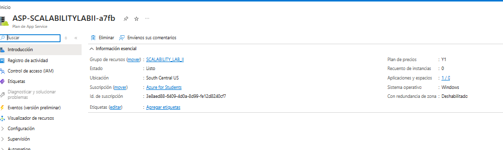
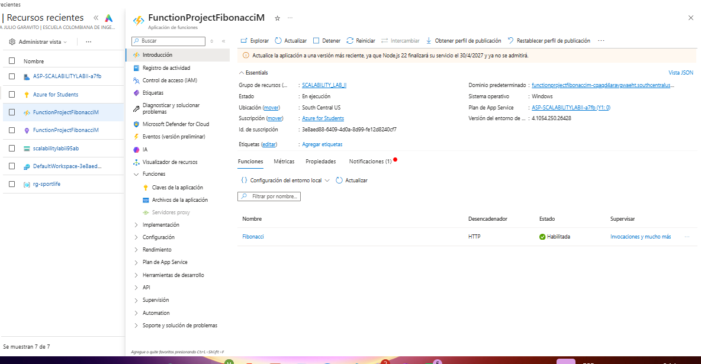
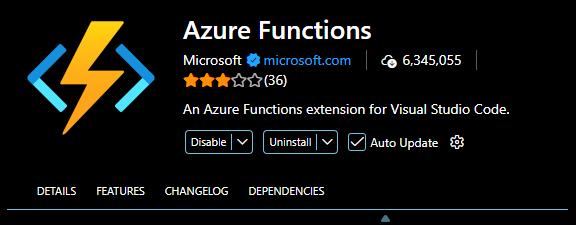
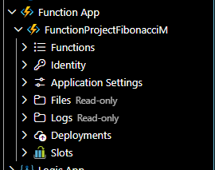
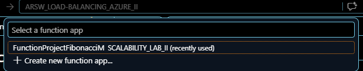
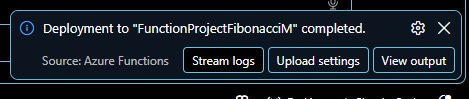
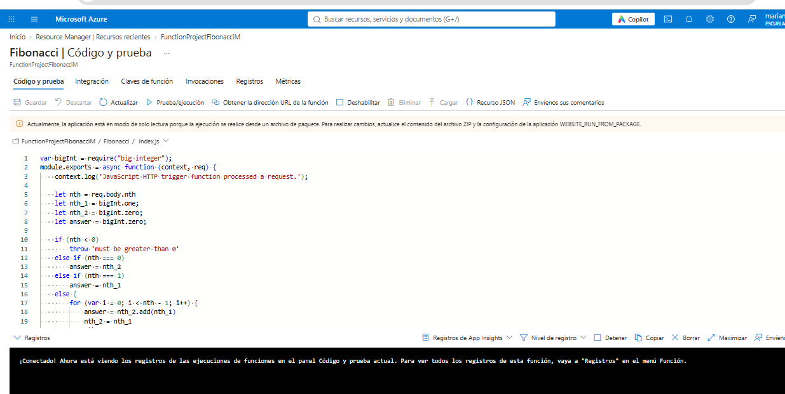
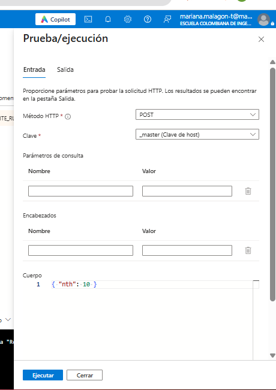
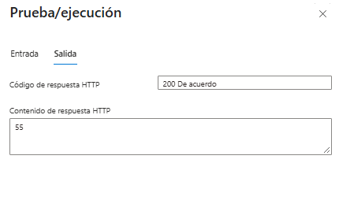
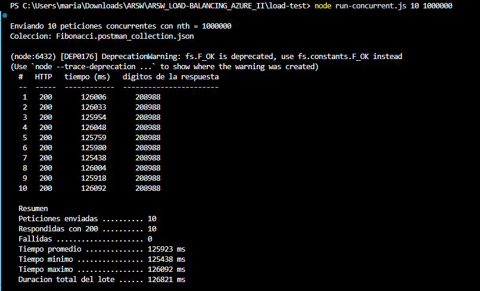

# Informe de Laboratorio: Escalabilidad Serverless con Azure Functions

### Escuela Colombiana de Ingeniería Julio Garavito
### Arquitecturas de Software - ARSW

**Integrantes:**
- Paula Lozano
- Mariana Malagón

**Fecha:** 2026-10-30

---

## Parte 0. Entendiendo el escenario de calidad

**Escenario de escalabilidad planteado:**

> Cuando un conjunto de usuarios consulta un enésimo número (superior a 1.000.000) de la
> secuencia de Fibonacci de forma concurrente y el sistema se encuentra bajo condiciones
> normales de operación, todas las peticiones deben ser respondidas y el consumo de CPU
> del sistema no puede superar el 70%.

| Elemento del escenario | Valor |
|---|---|
| Fuente | Conjunto de usuarios concurrentes |
| Estímulo | Petición del enésimo valor de Fibonacci (n > 1.000.000) |
| Artefacto | Azure Function App (`Fibonacci`) |
| Ambiente | Operación normal |
| Respuesta | Todas las peticiones son respondidas |
| Medida de respuesta | CPU del sistema ≤ 70% |

**Análisis previo:**

El escenario exige dos cosas que en principio se contradicen: responder todas las
peticiones concurrentes y, al mismo tiempo, no superar el 70% de consumo de CPU. Entender
por qué se tensionan entre sí obliga a mirar primero la naturaleza del cálculo.

**Por qué el cálculo es CPU-bound**

La function no consulta bases de datos, no lee archivos ni invoca servicios externos. Todo
su tiempo de ejecución es aritmética, de modo que ni la red ni el disco aparecen como
cuello de botella. Dos factores convierten ese cálculo en una carga pesada:

1. **El número de iteraciones crece linealmente con `n`.** El algoritmo recorre la
   secuencia una sola vez, así que para `n = 1.000.000` ejecuta un millón de sumas.
2. **Cada suma es progresivamente más cara.** El término n-ésimo de Fibonacci tiene
   aproximadamente `n * log10(φ) ≈ 0,209 * n` dígitos, por lo que `F(1.000.000)` supera los
   **208.000 dígitos**. Sumar dos números de ese tamaño no es una operación de costo
   constante: cuesta proporcional a la cantidad de dígitos. El costo total del cálculo no
   es lineal sino cuadrático, del orden de `O(n²)` operaciones elementales.

El consumo de memoria, en cambio, es modesto: el algoritmo conserva únicamente los dos
términos anteriores, unos cientos de kilobytes. No es un problema de memoria ni de entrada
y salida, es un problema de CPU.

A esto se suma una característica del runtime: el worker de Node.js es de un solo hilo. Un
handler que ocupa la CPU durante segundos **bloquea el event loop** de su instancia, así
que las peticiones que lleguen mientras tanto no se intercalan, se encolan. Una instancia
no puede resolver dos cálculos pesados a la vez, sin importar cuántos núcleos tenga la
máquina que la hospeda.

**Qué estrategia de escalamiento aplica**

De lo anterior se desprende que el escalamiento **vertical** sirve poco. Una máquina con
más núcleos no acelera un algoritmo secuencial de un solo hilo, y una con mayor frecuencia
de reloj solo aporta una mejora marginal. El eje correcto es el **horizontal**: más
instancias, cada una absorbiendo una petición.

La diferencia entre hacerlo con máquinas virtuales o Scale Sets y hacerlo con serverless
está en qué señal dispara el escalamiento y en cuánto tarda en responder:

| | VMs y Virtual Machine Scale Sets | Azure Functions (plan de Consumo) |
|---|---|---|
| Señal que dispara el escalamiento | Métricas del host, típicamente CPU sobre un umbral | Número de peticiones HTTP pendientes, medido por el *scale controller* |
| Tiempo de reacción | Minutos: aprovisionar la VM, arrancar el sistema operativo y la aplicación | Segundos: el host crea instancias sobre infraestructura ya disponible |
| Estado en reposo | Al menos una instancia encendida y facturada | Cero instancias, sin costo |
| Configuración | Reglas de autoescalado definidas manualmente | Implícita, administrada por la plataforma |

El punto decisivo es que con VMs la métrica que dispara el escalamiento es **la misma que
el escenario quiere mantener baja**. El autoescalado por CPU es reactivo: solo crece cuando
la CPU ya está saturada, y para cuando las instancias nuevas terminan de arrancar, varios
minutos después, las peticiones concurrentes ya se encolaron o fallaron. Se alcanzaría
"todas las peticiones son respondidas" o "CPU no superior al 70%", pero difícilmente ambas
a la vez.

El plan de Consumo rompe esa dependencia porque no escala mirando la CPU sino la cola de
peticiones: detecta diez peticiones concurrentes y crea instancias para atenderlas antes de
que la CPU de ninguna llegue al límite. La medida de respuesta del escenario se cumple por
**distribución** y no por contención: cada instancia ejecuta un cálculo y el consumo se
reparte en lugar de acumularse en un solo host.

Esa estrategia tiene un precio, que se contrasta con los resultados del Paso 5:

- **Arranque en frío.** Partir de cero instancias implica latencia adicional en la primera
  petición después de un período de inactividad.
- **Límite de duración.** Un trigger HTTP en el plan de Consumo debe responder antes de
  **230 segundos**, un tiempo fijo del balanceador que no depende del `functionTimeout`
  configurado. Para valores de `n` suficientemente grandes el cálculo puede superar ese
  umbral y la petición se corta, lo cual acota hasta dónde el escenario es alcanzable.
- **Ausencia de estado compartido.** Cada instancia es independiente y no comparte memoria
  con las demás, condición que resulta determinante en el Paso 6.

---

## Paso 1. Creación de la Function App

**Configuración usada:**

| Parámetro | Valor |
|---|---|
| Suscripción | Azure for Students |
| Resource Group | `SCALABILITY_LAB_II` |
| Function App name | `FunctionProjectFibonacciM` |
| Runtime stack | Node.js (`FUNCTIONS_WORKER_RUNTIME = node`) |
| Versión | 22 LTS (`WEBSITE_NODE_DEFAULT_VERSION = ~22`) |
| Versión del runtime de Functions | v4 (`FUNCTIONS_EXTENSION_VERSION = ~4`) |
| Región | South Central US |
| Sistema operativo | Windows |
| Plan | Consumo / Serverless (SKU `Y1`, tier `Dynamic`) |
| App Service Plan | `ASP-SCALABILITYLABII-a7fb` |
| Storage Account | `scalabilitylabii95ab` |
| Application Insights | `FunctionProjectFibonacciM` |
| Host | `functionprojectfibonaccim-cqaqd4aravgwaeht.southcentralus-01.azurewebsites.net` |

> **Nota sobre la versión de Node:** el enunciado muestra Node.js 12, versión que el portal
> ya no ofrece. Las opciones disponibles al momento de realizar el laboratorio son **22
> LTS** y **24 LTS**, y se seleccionó 22 LTS por ser la versión LTS en soporte estable. El
> proyecto entregado está escrito con el modelo de programación v3 de Node, el que declara
> los bindings en `function.json`, que la documentación de Microsoft lista como soportado
> sobre el runtime v4 en Node 22, de modo que el código se despliega sin modificaciones.

**Incidencia encontrada: región no permitida**

El enunciado indica usar la región **East US 2**, pero la creación de los recursos falla
allí con el error `RequestDisallowedByAzure`. La causa es una *Azure Policy* propia de las
suscripciones *Azure for Students*, llamada `Allowed resource deployment regions`, que
restringe el despliegue a una lista blanca: South Central US, North Central US, Canada
Central, Brazil South y Chile Central. Se seleccionó **South Central US** por ser la de
menor latencia desde Colombia entre las permitidas, criterio relevante para las pruebas de
concurrencia del Paso 5.

**Capturas:**



<!--  -->
<!--  -->

**Explicación:**

Crear una Function App no genera un único recurso, sino cuatro piezas que trabajan juntas:

| Recurso | Función en la arquitectura |
|---|---|
| Function App | Contenedor lógico de las functions. Expone el host HTTP y ejecuta el código. |
| App Service Plan (`Y1`, tier `Dynamic`) | Define el modelo de cómputo. `Y1` es el SKU del plan de Consumo, el que habilita el escalamiento automático por demanda. |
| Storage Account | Guarda el contenido de la aplicación, el estado interno del host y los triggers. |
| Application Insights | Recoge métricas, trazas y conteo de ejecuciones, necesarias para medir el escenario de calidad. |

El dato relevante para el escenario de escalabilidad es el **tier `Dynamic`** del plan. A
diferencia de un plan dedicado, donde el número de instancias es fijo y el escalamiento se
configura de forma explícita, el plan de Consumo arranca con **cero instancias** (como se
ve en la captura, `Recuento de instancias: 0`) y Azure crea instancias nuevas únicamente
cuando llegan peticiones. Esto es lo que se pone a prueba en el Paso 5.

---

## Paso 2. Despliegue de la function a Azure

Siguiendo los puntos 2 y 3 del enunciado, la function se desplegó desde el entorno local
con la extensión de **Azure Functions para Visual Studio Code**. El procedimiento fue:

1. Instalación de la extensión `ms-azuretools.vscode-azurefunctions` desde el marketplace
   del editor.
2. Autenticación contra la suscripción *Azure for Students* desde el panel de Azure, que
   expone la Function App `FunctionProjectFibonacciM` con sus nodos de Functions,
   Application Settings, Files, Logs y Deployments.
3. Ejecución del comando **Azure Functions: Deploy to Function App...**, indicando
   `FunctionProject` como raíz del proyecto (es la carpeta que contiene el `host.json`) y
   `FunctionProjectFibonacciM` como destino.

Internamente la extensión realiza un *zip deploy* contra el endpoint SCM (Kudu) de la
Function App: empaqueta el proyecto completo, incluida la carpeta `node_modules`, y el
servicio publica ese paquete como contenido de la aplicación. La operación equivalente
desde el Azure CLI, útil para repetir el despliegue sin abrir el editor, es:

```bash
az functionapp deployment source config-zip \
  -g SCALABILITY_LAB_II \
  -n FunctionProjectFibonacciM \
  --src fibonacci-deploy.zip
```

**Por qué no se editó la function desde el portal**

El portal de Azure ofrece un editor web (*Code + Test*) que permite escribir la function
sin salir del navegador. Se descartó esa opción por dos razones:

1. El proyecto entregado depende del paquete npm `big-integer`, y el editor del portal no
   permite instalar dependencias. Usarlo obligaría a reescribir el algoritmo, apartándose
   del código que entregó el profesor.
2. Las dos opciones son **excluyentes**. La documentación de Microsoft indica que la
   edición en el portal queda deshabilitada en cuanto se despliega código desde afuera: el
   despliegue define la variable `WEBSITE_RUN_FROM_PACKAGE` y el portal pasa a modo de
   solo lectura para no sobrescribir el paquete publicado.

Como el enunciado pide explícitamente desplegar desde el entorno local, se tomó ese camino
y se asume el portal como herramienta de prueba y monitoreo, no de edición.

**Ajustes necesarios antes del despliegue**

1. **Extension bundle desactualizado.** El `host.json` del proyecto declaraba
   `"version": "[1.*, 2.0.0)"`, que corresponde a la generación del runtime v2. La Function
   App creada corre sobre el **runtime v4**, cuyo bundle equivalente es `[4.*, 5.0.0)`.
   Mantener el valor viejo expone la aplicación a fallos de arranque del host, así que se
   actualizó.
2. **Dependencias sin instalar.** El repositorio no incluye `node_modules` (está en el
   `.gitignore`, como corresponde). Dado que el despliegue sobre Windows no ejecuta un
   build remoto para Node, las dependencias deben viajar dentro del paquete, por lo que se
   ejecutó `npm install --omit=dev` antes de comprimir.

**Resultado del despliegue**

El editor reportó la operación como completada:

```
Deployment to "FunctionProjectFibonacciM" completed.
```

Verificación de que la function quedó registrada en el host:

```bash
az functionapp function list -g SCALABILITY_LAB_II -n FunctionProjectFibonacciM -o table
```

| Name | Trigger | Auth |
|---|---|---|
| `FunctionProjectFibonacciM/Fibonacci` | `httpTrigger` | `anonymous` |

El nivel de autorización **anónimo** viene declarado en el `function.json` del proyecto y
es importante para el Paso 5: permite que Newman envíe las peticiones concurrentes sin
necesidad de una *function key*.

**Capturas:**








<!--  -->
<!--  -->

---

## Paso 3. Código de la function

La function desplegada es la que venía en el proyecto entregado, sin modificaciones en su
lógica. Está escrita con el **modelo de programación v3** de Node.js, que declara los
bindings en un archivo aparte en lugar de hacerlo por código.

**`FunctionProject/Fibonacci/function.json`**

```json
{
  "bindings": [
    { "authLevel": "anonymous", "type": "httpTrigger", "direction": "in",
      "name": "req", "methods": ["get", "post"] },
    { "type": "http", "direction": "out", "name": "res" }
  ]
}
```

El binding de entrada define un disparador HTTP anónimo que acepta GET y POST, y lo expone
al código como `req`. El de salida devuelve la respuesta a través de `context.res`.

**`FunctionProject/Fibonacci/index.js`**

El algoritmo es **iterativo**: recorre la secuencia una sola vez acumulando los dos
términos anteriores, con complejidad `O(n)` en tiempo y `O(1)` en memoria.

```js
for (var i = 0; i < nth - 1; i++) {
    answer = nth_2.add(nth_1)
    nth_2 = nth_1
    nth_1 = answer
}
```

Dos decisiones del código merecen comentario:

- **Uso de `big-integer`.** El tipo `Number` de JavaScript pierde precisión más allá de
  2^53, y Fibonacci la supera alrededor del término 79. Como el escenario de calidad habla
  de valores superiores a 1.000.000, cualquier resultado calculado con `Number` sería
  basura numérica. La librería implementa enteros de precisión arbitraria.
- **Costo creciente por petición.** El precio de esa precisión es que las sumas dejan de
  ser operaciones de costo constante: el término un millón de la secuencia tiene más de
  200.000 dígitos, y sumar números de ese tamaño es cada vez más caro. El resultado es que
  una sola petición satura un núcleo durante segundos, que es exactamente la condición que
  hace interesante el escenario de escalabilidad.

**Capturas:**

<!--  -->

---

## Paso 4. Prueba de la Function desde el portal de Azure

**Petición enviada:**

```json
{ "nth": 10 }
```

**Capturas:**

<!--  -->
<!--  -->

**Resultado:**

_(pendiente)_

---

## Paso 5. Pruebas de carga: 10 peticiones concurrentes con Newman

**Comando ejecutado:**

```bash
(pendiente)
```

**Resultados:**

| Métrica | Valor |
|---|---|
| Peticiones enviadas | |
| Peticiones respondidas | |
| Fallidas | |
| Tiempo de respuesta promedio | |
| Tiempo de respuesta mínimo / máximo | |
| Duración total | |

**Capturas:**

<!--  -->
<!--  -->

**Análisis:**

_(pendiente: ¿se respondieron todas las peticiones? ¿cómo se comportó el escalamiento
automático del plan de consumo? ¿se cumple el escenario de calidad?)_

---

## Paso 6. Function recursiva con memoization

**Implementación:** `FunctionProject/FibonacciMemo/index.js`

**Pruebas realizadas:**

| # | `nth` | Momento | Tiempo de respuesta | ¿Cache hit? |
|---|---|---|---|---|
| 1 | | Primera ejecución | | |
| 2 | | Repetición inmediata | | |
| 3 | | Después de 5+ min de inactividad | | |

**Capturas:**

<!--  -->
<!--  -->

**Comportamiento observado:**

_(pendiente)_

---

## Preguntas

### 1. ¿Qué es un Azure Function?

_(pendiente)_

### 2. ¿Qué es serverless?

_(pendiente)_

### 3. ¿Qué es el runtime y qué implica seleccionarlo al momento de crear el Function App?

_(pendiente)_

### 4. ¿Por qué es necesario crear un Storage Account de la mano de un Function App?

_(pendiente)_

### 5. ¿Cuáles son los tipos de planes para un Function App? ¿En qué se diferencian? Ventajas y desventajas de cada uno

_(pendiente)_

### 6. ¿Por qué la memoization falla o no funciona de forma correcta?

_(pendiente)_

### 7. ¿Cómo funciona el sistema de facturación de las Function App?

_(pendiente)_

---

## Conclusiones

_(pendiente)_
