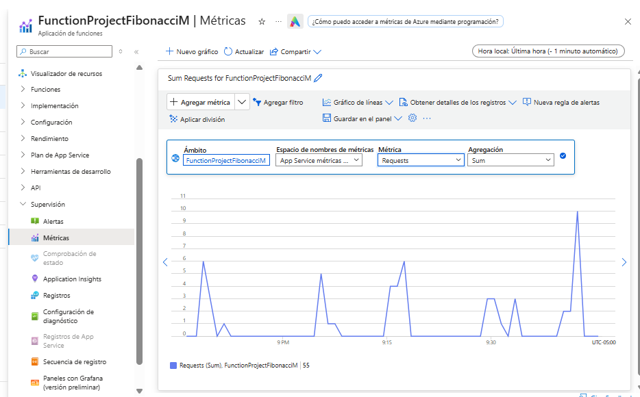
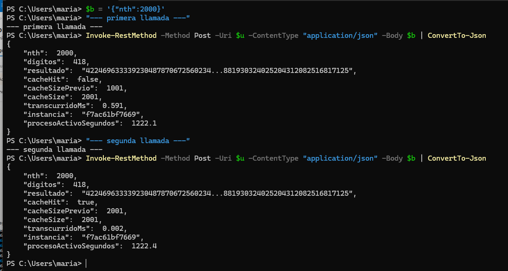

# Informe de Laboratorio: Escalabilidad Serverless con Azure Functions

### Escuela Colombiana de Ingeniería Julio Garavito
### Arquitecturas de Software - ARSW

**Integrantes:**
- Paula Lozano
- Mariana Malagón

**Fecha:** 2026-11-03

**Sustentación en video:** https://youtu.be/NOVY7lKHwrg

La Function App no se mantiene activa, para evitar consumo de créditos de la suscripción,
por lo que el host que aparece en este informe ya no responde. El video queda como evidencia
de su funcionamiento. Para repetir las pruebas basta con desplegar de nuevo el proyecto y
actualizar `baseUrl` en la colección de `load-test/`.

| Evidencia en el video | Minuto |
|---|---|
| Prueba de `Fibonacci` con `nth = 10`, respuesta 55 | 0:49 |
| Línea base: una petición con `n = 1.000.000` | 1:51 |
| Lote de 10 peticiones concurrentes y análisis de tiempos | 2:44 |
| Métricas de la Function App en Azure | 5:49 |
| Memoization: llamadas repetidas con el mismo valor | 6:26 |
| Explicación de la permanencia de la cache: inactividad, reinicio y redespliegue | 7:05 |

---

## Parte 0. Entendiendo el escenario de calidad

**Escenario de escalabilidad planteado:**

> Cuando un conjunto de usuarios consulta un enésimo número (superior a 1.000.000) de la
> secuencia de Fibonacci de forma concurrente y el sistema se encuentra bajo condiciones
> normales de operación, todas las peticiones deben ser respondidas y el consumo de CPU
> del sistema no puede superar el 70%.

| Elemento del escenario | Valor |
|---|---|
| Fuente | Conjunto de usuarios concurrentes |
| Estímulo | Petición del enésimo valor de Fibonacci (n > 1.000.000) |
| Artefacto | Azure Function App (`Fibonacci`) |
| Ambiente | Operación normal |
| Respuesta | Todas las peticiones son respondidas |
| Medida de respuesta | CPU del sistema ≤ 70% |

**Análisis previo:**

El escenario exige dos cosas que en principio se contradicen: responder todas las
peticiones concurrentes y, al mismo tiempo, no superar el 70% de consumo de CPU. Entender
por qué se tensionan entre sí obliga a mirar primero la naturaleza del cálculo.

**Por qué el cálculo es CPU-bound**

La function no consulta bases de datos, no lee archivos ni invoca servicios externos. Todo
su tiempo de ejecución es aritmética, de modo que ni la red ni el disco aparecen como
cuello de botella. Dos factores convierten ese cálculo en una carga pesada:

1. **El número de iteraciones crece linealmente con `n`.** El algoritmo recorre la
   secuencia una sola vez, así que para `n = 1.000.000` ejecuta un millón de sumas.
2. **Cada suma es progresivamente más cara.** El término n-ésimo de Fibonacci tiene
   aproximadamente `n * log10(φ) ≈ 0,209 * n` dígitos, por lo que `F(1.000.000)` supera los
   **208.000 dígitos**. Sumar dos números de ese tamaño no es una operación de costo
   constante: cuesta proporcional a la cantidad de dígitos. El costo total del cálculo no
   es lineal sino cuadrático, del orden de `O(n²)` operaciones elementales.

El consumo de memoria, en cambio, es modesto: el algoritmo conserva únicamente los dos
términos anteriores, unos cientos de kilobytes. No es un problema de memoria ni de entrada
y salida, es un problema de CPU.

A esto se suma una característica del runtime: el worker de Node.js es de un solo hilo. Un
handler que ocupa la CPU durante segundos **bloquea el event loop** de su instancia, así
que las peticiones que lleguen mientras tanto no se intercalan, se encolan. Una instancia
no puede resolver dos cálculos pesados a la vez, sin importar cuántos núcleos tenga la
máquina que la hospeda.

**Qué estrategia de escalamiento aplica**

De lo anterior se desprende que el escalamiento **vertical** sirve poco. Una máquina con
más núcleos no acelera un algoritmo secuencial de un solo hilo, y una con mayor frecuencia
de reloj solo aporta una mejora marginal. El eje correcto es el **horizontal**: más
instancias, cada una absorbiendo una petición.

La diferencia entre hacerlo con máquinas virtuales o Scale Sets y hacerlo con serverless
está en qué señal dispara el escalamiento y en cuánto tarda en responder:

| | VMs y Virtual Machine Scale Sets | Azure Functions (plan de Consumo) |
|---|---|---|
| Señal que dispara el escalamiento | Métricas del host, típicamente CPU sobre un umbral | Número de peticiones HTTP pendientes, medido por el *scale controller* |
| Tiempo de reacción | Minutos: aprovisionar la VM, arrancar el sistema operativo y la aplicación | Segundos: el host crea instancias sobre infraestructura ya disponible |
| Estado en reposo | Al menos una instancia encendida y facturada | Cero instancias, sin costo |
| Configuración | Reglas de autoescalado definidas manualmente | Implícita, administrada por la plataforma |

El punto decisivo es que con VMs la métrica que dispara el escalamiento es **la misma que
el escenario quiere mantener baja**. El autoescalado por CPU es reactivo: solo crece cuando
la CPU ya está saturada, y para cuando las instancias nuevas terminan de arrancar, varios
minutos después, las peticiones concurrentes ya se encolaron o fallaron. Se alcanzaría
"todas las peticiones son respondidas" o "CPU no superior al 70%", pero difícilmente ambas
a la vez.

Sobre el papel, el plan de Consumo rompe esa dependencia porque no escala mirando la CPU
sino la cola de peticiones. De ahí se desprende la **hipótesis de partida** de este
laboratorio: que el *scale controller* detecte las diez peticiones concurrentes y cree
instancias para atenderlas antes de que la CPU de ninguna llegue al límite, de modo que la
medida de respuesta se cumpla por **distribución** y no por contención, con cada instancia
ejecutando un cálculo y el consumo repartido en lugar de acumulado en un solo host.

Conviene enunciarla como hipótesis y no como conclusión, porque el Paso 5 la somete a
prueba con una ráfaga de diez peticiones simultáneas y los tiempos medidos no la
confirman.

Esa estrategia tiene un precio, que se contrasta con los resultados del Paso 5:

- **Arranque en frío.** Partir de cero instancias implica latencia adicional en la primera
  petición después de un período de inactividad.
- **Límite de duración.** Un trigger HTTP en el plan de Consumo debe responder antes de
  **230 segundos**, un tiempo fijo del balanceador que no depende del `functionTimeout`
  configurado. Para valores de `n` suficientemente grandes el cálculo puede superar ese
  umbral y la petición se corta, lo cual acota hasta dónde el escenario es alcanzable.
- **Ausencia de estado compartido.** Cada instancia es independiente y no comparte memoria
  con las demás, condición que resulta determinante en el Paso 6.

---

## Paso 1. Creación de la Function App

**Configuración usada:**

| Parámetro | Valor |
|---|---|
| Suscripción | Azure for Students |
| Resource Group | `SCALABILITY_LAB_II` |
| Function App name | `FunctionProjectFibonacciM` |
| Runtime stack | Node.js (`FUNCTIONS_WORKER_RUNTIME = node`) |
| Versión | 22 LTS (`WEBSITE_NODE_DEFAULT_VERSION = ~22`) |
| Versión del runtime de Functions | v4 (`FUNCTIONS_EXTENSION_VERSION = ~4`) |
| Región | South Central US |
| Sistema operativo | Windows |
| Plan | Consumo / Serverless (SKU `Y1`, tier `Dynamic`) |
| App Service Plan | `ASP-SCALABILITYLABII-a7fb` |
| Storage Account | `scalabilitylabii95ab` |
| Application Insights | `FunctionProjectFibonacciM` |
| Host | `functionprojectfibonaccim-cqaqd4aravgwaeht.southcentralus-01.azurewebsites.net` |

> **Nota sobre la versión de Node:** el enunciado muestra Node.js 12, versión que el portal
> ya no ofrece. Las opciones disponibles al momento de realizar el laboratorio son **22
> LTS** y **24 LTS**, y se seleccionó 22 LTS por ser la versión LTS en soporte estable. El
> proyecto entregado está escrito con el modelo de programación v3 de Node, el que declara
> los bindings en `function.json`, que la documentación de Microsoft lista como soportado
> sobre el runtime v4 en Node 22, de modo que el código se despliega sin modificaciones.

**Incidencia encontrada: región no permitida**

El enunciado indica usar la región **East US 2**, pero la creación de los recursos falla
allí con el error `RequestDisallowedByAzure`. La causa es una *Azure Policy* propia de las
suscripciones *Azure for Students*, llamada `Allowed resource deployment regions`, que
restringe el despliegue a una lista blanca: South Central US, North Central US, Canada
Central, Brazil South y Chile Central. Se seleccionó **South Central US** por ser la de
menor latencia desde Colombia entre las permitidas, criterio relevante para las pruebas de
concurrencia del Paso 5.

**Capturas:**


**Explicación:**

Crear una Function App no genera un único recurso, sino cuatro piezas que trabajan juntas:

| Recurso | Función en la arquitectura |
|---|---|
| Function App | Contenedor lógico de las functions. Expone el host HTTP y ejecuta el código. |
| App Service Plan (`Y1`, tier `Dynamic`) | Define el modelo de cómputo. `Y1` es el SKU del plan de Consumo, el que habilita el escalamiento automático por demanda. |
| Storage Account | Guarda el contenido de la aplicación, el estado interno del host y los triggers. |
| Application Insights | Recoge métricas, trazas y conteo de ejecuciones, necesarias para medir el escenario de calidad. |

El dato relevante para el escenario de escalabilidad es el **tier `Dynamic`** del plan. A
diferencia de un plan dedicado, donde el número de instancias es fijo y el escalamiento se
configura de forma explícita, el plan de Consumo arranca con **cero instancias** (como se
ve en la captura, `Recuento de instancias: 0`) y Azure crea instancias nuevas únicamente
cuando llegan peticiones. Esto es lo que se pone a prueba en el Paso 5.

---

## Paso 2. Despliegue de la function a Azure

Siguiendo los puntos 2 y 3 del enunciado, la function se desplegó desde el entorno local
con la extensión de **Azure Functions para Visual Studio Code**. El procedimiento fue:

1. Instalación de la extensión `ms-azuretools.vscode-azurefunctions` desde el marketplace
   del editor.
2. Autenticación contra la suscripción *Azure for Students* desde el panel de Azure, que
   expone la Function App `FunctionProjectFibonacciM` con sus nodos de Functions,
   Application Settings, Files, Logs y Deployments.
3. Ejecución del comando **Azure Functions: Deploy to Function App...**, indicando
   `FunctionProject` como raíz del proyecto (es la carpeta que contiene el `host.json`) y
   `FunctionProjectFibonacciM` como destino.

Internamente la extensión realiza un *zip deploy* contra el endpoint SCM (Kudu) de la
Function App: empaqueta el proyecto completo, incluida la carpeta `node_modules`, y el
servicio publica ese paquete como contenido de la aplicación. La operación equivalente
desde el Azure CLI, útil para repetir el despliegue sin abrir el editor, es:

```bash
az functionapp deployment source config-zip \
  -g SCALABILITY_LAB_II \
  -n FunctionProjectFibonacciM \
  --src fibonacci-deploy.zip
```

**Por qué no se editó la function desde el portal**

El portal de Azure ofrece un editor web (*Code + Test*) que permite escribir la function
sin salir del navegador. Se descartó esa opción por dos razones:

1. El proyecto entregado depende del paquete npm `big-integer`, y el editor del portal no
   permite instalar dependencias. Usarlo obligaría a reescribir el algoritmo, apartándose
   del código que entregó el profesor.
2. Las dos opciones son **excluyentes**. La documentación de Microsoft indica que la
   edición en el portal queda deshabilitada en cuanto se despliega código desde afuera: el
   despliegue define la variable `WEBSITE_RUN_FROM_PACKAGE` y el portal pasa a modo de
   solo lectura para no sobrescribir el paquete publicado.

Como el enunciado pide explícitamente desplegar desde el entorno local, se tomó ese camino
y se asume el portal como herramienta de prueba y monitoreo, no de edición.

**Ajustes necesarios antes del despliegue**

1. **Extension bundle desactualizado.** El `host.json` del proyecto declaraba
   `"version": "[1.*, 2.0.0)"`, que corresponde a la generación del runtime v2. La Function
   App creada corre sobre el **runtime v4**, cuyo bundle equivalente es `[4.*, 5.0.0)`.
   Mantener el valor viejo expone la aplicación a fallos de arranque del host, así que se
   actualizó.
2. **Dependencias sin instalar.** El repositorio no incluye `node_modules` (está en el
   `.gitignore`, como corresponde). Dado que el despliegue sobre Windows no ejecuta un
   build remoto para Node, las dependencias deben viajar dentro del paquete, por lo que se
   ejecutó `npm install --omit=dev` antes de comprimir.

**Resultado del despliegue**

El editor reportó la operación como completada:

```
Deployment to "FunctionProjectFibonacciM" completed.
```

Verificación de que la function quedó registrada en el host:

```bash
az functionapp function list -g SCALABILITY_LAB_II -n FunctionProjectFibonacciM -o table
```

| Name | Trigger | Auth |
|---|---|---|
| `FunctionProjectFibonacciM/Fibonacci` | `httpTrigger` | `anonymous` |

El nivel de autorización **anónimo** viene declarado en el `function.json` del proyecto y
es importante para el Paso 5: permite que Newman envíe las peticiones concurrentes sin
necesidad de una *function key*.

**Capturas:**


---

## Paso 3. Código de la function

La function desplegada es la que venía en el proyecto entregado, sin modificaciones en su
lógica. Está escrita con el **modelo de programación v3** de Node.js, que declara los
bindings en un archivo aparte en lugar de hacerlo por código.

**`FunctionProject/Fibonacci/function.json`**

```json
{
  "bindings": [
    { "authLevel": "anonymous", "type": "httpTrigger", "direction": "in",
      "name": "req", "methods": ["get", "post"] },
    { "type": "http", "direction": "out", "name": "res" }
  ]
}
```

El binding de entrada define un disparador HTTP anónimo que acepta GET y POST, y lo expone
al código como `req`. El de salida devuelve la respuesta a través de `context.res`.

**`FunctionProject/Fibonacci/index.js`**

El algoritmo es **iterativo**: recorre la secuencia una sola vez acumulando los dos
términos anteriores, con `O(n)` sumas y sin conservar los términos ya superados. Como cada
suma cuesta más a medida que crecen los números, el costo total es el `O(n²)` descrito en
la Parte 0.

```js
for (var i = 0; i < nth - 1; i++) {
    answer = nth_2.add(nth_1)
    nth_2 = nth_1
    nth_1 = answer
}
```

Dos decisiones del código merecen comentario:

- **Uso de `big-integer`.** El tipo `Number` de JavaScript pierde precisión más allá de
  2^53, y Fibonacci la supera alrededor del término 79. Como el escenario de calidad habla
  de valores superiores a 1.000.000, cualquier resultado calculado con `Number` sería
  basura numérica. La librería implementa enteros de precisión arbitraria.
- **Costo creciente por petición.** El precio de esa precisión es que las sumas dejan de
  ser operaciones de costo constante: el término un millón de la secuencia tiene más de
  200.000 dígitos, y sumar números de ese tamaño es cada vez más caro. El resultado es que
  una sola petición satura un núcleo durante segundos, que es exactamente la condición que
  hace interesante el escenario de escalabilidad.

El código tal como quedó publicado en Azure puede verse en la captura del editor del
portal incluida en el Paso 2.

---

## Paso 4. Prueba de la Function desde el portal de Azure

La prueba se realizó con la herramienta **Probar/ejecutar** del editor del portal, que
permite componer una petición HTTP contra la function sin salir del navegador.

**Petición enviada:**

| Campo | Valor |
|---|---|
| Método HTTP | `POST` |
| Clave | `_master`, la clave de host que el panel propone por defecto |
| Cuerpo | `{ "nth": 10 }` |

El método debe cambiarse explícitamente a `POST`. El panel propone `GET`, pero la function
lee el parámetro desde `req.body.nth` y en una petición GET no existe cuerpo, de modo que
el acceso a esa propiedad falla y el host responde con un error 500.

**Resultado:**

| Campo | Valor |
|---|---|
| Código de respuesta HTTP | `200 De acuerdo` |
| Contenido de respuesta | `55` |

El valor es correcto: el décimo término de la secuencia de Fibonacci es 55. Con esto la
function queda verificada de extremo a extremo, desde el disparador HTTP hasta la
respuesta, que es la condición necesaria para pasar a las pruebas de carga del Paso 5.

**Capturas:**


---

## Paso 5. Pruebas de carga: 10 peticiones concurrentes con Newman

**Cómo se consigue la concurrencia**

Conviene aclarar un punto que define el diseño de esta prueba: **Newman no envía
peticiones concurrentes**. Una ejecución de `newman run` recorre los requests de la
colección de forma secuencial, y la opción `-n` solo repite la colección, también en
serie. La concurrencia se obtiene lanzando varias ejecuciones de Newman al mismo tiempo.

Para ello se construyeron dos artefactos, ubicados en la carpeta `load-test/`:

| Archivo | Contenido |
|---|---|
| `Fibonacci.postman_collection.json` | Colección de Postman con la petición `POST /api/Fibonacci`, su cuerpo parametrizado y dos tests que validan el código 200 y que la respuesta sea numérica. El host y el valor de `n` son variables de colección. |
| `run-concurrent.js` | Script que dispara N ejecuciones simultáneas de esa colección con la API de Node de Newman, espera a que todas terminen y tabula los tiempos. |

**Comando ejecutado:**

```bash
cd load-test
node run-concurrent.js 10 1000000
```

**Línea base: comportamiento de una petición aislada**

Antes de medir la concurrencia se midió el costo de una sola petición para distintos
valores de `n`, lo que permite separar el efecto del algoritmo del efecto de la carga:

| `n` | Tiempo de respuesta | Dígitos del resultado |
|---|---|---|
| 10.000 | 0,32 s | 2.090 |
| 200.000 | 1,28 s | 41.798 |
| 500.000 | 4,14 s | 104.494 |
| 1.000.000 | 13,78 s | 208.988 |
| 2.000.000 | 90,70 s | 417.975 |

El crecimiento es claramente superlineal, consistente con el costo cuadrático anticipado
en la Parte 0: duplicar `n` de 500.000 a 1.000.000 multiplica el tiempo por 3,3. Además,
la cantidad de dígitos observada en la respuesta para `n = 1.000.000`, **208.988**,
coincide con la estimación planteada en el análisis previo. La medición de la misma petición
que aparece en el video dio 13,1 s, del mismo orden.

**Resultados de las 10 peticiones concurrentes**

| Métrica | Valor |
|---|---|
| Peticiones enviadas | 10 |
| Peticiones respondidas | 10, todas con HTTP 200 |
| Fallidas | 0 |
| Tiempo de respuesta promedio | 125.923 ms (125,9 s) |
| Tiempo de respuesta mínimo / máximo | 125.438 ms / 126.092 ms |
| Duración total del lote | 126.821 ms (126,8 s) |
| Dígitos de cada respuesta | 208.988 |

**Capturas:**




**Análisis**

La prueba se ejecutó dos veces en momentos distintos y arrojó valores equivalentes. La
segunda corrida, que es la que aparece en el video, dio un promedio de 125.852 ms, un
mínimo de 125.683 ms, un máximo de 125.971 ms y una duración total de 126.664 ms, con las
diez respuestas devolviendo los mismos 208.988 dígitos. La reproducibilidad descarta que
lo observado sea una anomalía puntual de la plataforma.

El resultado más revelador no es que todas las peticiones hayan respondido, sino **cuánto
tardaron en hacerlo**. Una petición aislada con el mismo valor de `n` tarda 13,8 segundos;
bajo concurrencia tardó 125,9 segundos, un factor de **9,1x**.

Tres observaciones sobre la forma de los datos:

1. **La dispersión es mínima.** Entre la petición más rápida y la más lenta hay 654 ms,
   menos del 1 por ciento. Las diez terminaron prácticamente juntas.
2. **Las respuestas no llegaron escalonadas.** Si cada respuesta se hubiera entregado apenas
   terminara su cálculo en una cola estricta, los tiempos habrían sido 14 s, 28 s, 42 s, y
   así sucesivamente. En cambio llegaron juntas, señal de que las diez peticiones
   **compartieron la misma capacidad de cómputo**. Esto precisa lo dicho en la sustentación,
   donde se describió como ejecución simultánea: como el worker de Node es de un solo hilo
   (Parte 0), los tiempos no permiten afirmar que los cálculos avanzaran a la vez. También
   es posible que se resolvieran uno tras otro y que las respuestas salieran juntas al
   liberarse el event loop. Distinguir ambos casos exigiría marcas de tiempo por invocación.
3. **El tiempo total equivale al trabajo serializado.** Diez peticiones por 13,8 s dan
   138 s de cómputo, y el lote completo tardó 126,8 s. El sistema hizo el trabajo de las
   diez en el tiempo que le habría tomado hacerlas una tras otra, sin ganancia alguna por
   paralelismo.

La conclusión, inferida de estos tiempos porque no se registró el recuento de instancias,
es que **Azure no escaló a diez instancias durante la ráfaga**. El *scale controller* del
plan de Consumo evalúa la carga de forma periódica y agrega instancias de manera gradual.
Una ráfaga en la que las diez peticiones llegan en el mismo instante puede encontrar la
aplicación con pocas instancias activas, y como cada petición ocupa la CPU de inmediato y
no la libera, el escalamiento no alcanza a materializarse antes de que el lote termine. El
escalamiento automático es real, pero no es instantáneo.

Este resultado **refuta la hipótesis planteada en la Parte 0**. El escenario no se
satisfizo por distribución sino por contención: la ventaja del escalamiento dirigido por
eventos es cierta como mecanismo, pero necesita más tiempo del que dura una ráfaga de dos
minutos para traducirse en instancias nuevas. La predicción erró en el plazo, no en el
principio.

**Métricas registradas por Azure**

| Métrica | Valor durante la ráfaga |
|---|---|
| Recuento de ejecuciones de función | 10 |
| Unidades de ejecución de función | 159.296.256 MB-ms, repartidos en tres minutos |
| Tiempo de respuesta promedio | 124,47 s |
| Peticiones en cola de aplicación | 0 |

La última fila merece atención: la cola del front end HTTP permaneció vacía durante toda
la prueba. La demora no se produjo esperando turno para entrar a la aplicación, sino
dentro de ella, a la espera de CPU disponible. Esto es coherente con lo descrito en el
punto 2.

Las unidades de ejecución permiten además verificar el modelo de facturación: diez
peticiones por 126 s por 128 MB de memoria asignada dan aproximadamente 161 millones de
MB-ms, muy cerca de los 159,3 millones medidos. El dato tiene una implicación económica:
como se factura tiempo de reloj y no tiempo de CPU útil, **la contención multiplicó el
costo por nueve**. Las mismas diez respuestas, servidas por diez instancias en paralelo,
habrían costado alrededor de la novena parte.

**Evaluación del escenario de calidad**

Se cumple parcialmente, y la distinción es importante:

| Elemento del escenario | Resultado |
|---|---|
| Todas las peticiones son respondidas | **Se cumple.** 10 de 10 con HTTP 200 y 208.988 dígitos, la cantidad esperada para `F(1.000.000)` |
| CPU del sistema no superior al 70% | **No comprobable de forma directa y, por evidencia indirecta, no se cumple** |

La medida de respuesta del escenario resulta ser **inobservable en el plan de Consumo**:
Azure no expone un porcentaje de CPU para este plan, porque no existe un host fijo
asignado a la aplicación que se pueda medir. Lo que expone son unidades de ejecución. La
evidencia indirecta, un tiempo de respuesta multiplicado por nueve, indica que la CPU
disponible estuvo saturada durante los dos minutos que duró la prueba.

Hay además un riesgo que la prueba deja a la vista: los 126,8 segundos están a mitad de
camino del **límite de 230 segundos** del balanceador descrito en la Parte 0. Duplicar la
concurrencia, o mantenerla y usar `n = 2.000.000`, llevaría las peticiones por encima de
ese umbral y Azure las cortaría. El escenario, tal como está enunciado, es alcanzable en
disponibilidad pero frágil en latencia.

En síntesis, en esta prueba **ninguna petición se perdió**, un resultado valioso y difícil
de conseguir con un Scale Set reaccionando por umbral de CPU. Lo que el modelo no garantizó
fue el tiempo de respuesta, porque el escalamiento horizontal necesita tiempo para
materializarse y la ráfaga fue más rápida que él.

---

## Paso 6. Function recursiva con memoization

**Implementación**

La nueva function se creó en `FunctionProject/FibonacciMemo/`, con los mismos bindings que
la original (disparador HTTP anónimo) y un algoritmo distinto: recursión con una tabla de
resultados ya calculados.

```js
var cache = new Map();
cache.set(0, bigInt.zero);
cache.set(1, bigInt.one);

function fibonacci(n) {
    if (cache.has(n)) {
        return cache.get(n);
    }
    var valor = fibonacci(n - 1).add(fibonacci(n - 2));
    cache.set(n, valor);
    return valor;
}
```

El detalle decisivo es **dónde vive la cache**. El `Map` se declara en el ámbito del
módulo y no dentro del handler, de manera que no se reinicia en cada petición: sobrevive
mientras el proceso de Node que lo contiene siga activo. Esa decisión es la que convierte
al Paso 6 en un experimento sobre el ciclo de vida de las instancias y no sobre el
algoritmo.

Para hacer el experimento medible, la function responde en JSON con metadatos de su propia
ejecución, además del resultado:

| Campo | Qué permite observar |
|---|---|
| `cacheHit` | Si el valor pedido ya estaba memoizado al llegar la petición |
| `cacheSizePrevio` y `cacheSize` | Cuántos términos había antes y después de atender |
| `transcurridoMs` | El tiempo de cómputo, aislado de la latencia de red |
| `instancia` | Identificador de la instancia que atendió, tomado de `WEBSITE_INSTANCE_ID` |
| `procesoActivoSegundos` | Segundos que lleva vivo el proceso, vía `process.uptime()` |

Los dos últimos campos son los que permiten distinguir una cache perdida por reciclaje de
una cache perdida por haber caído en otra instancia.

**Pruebas realizadas**

| # | `nth` | Momento | Tiempo de cómputo | ¿Cache hit? |
|---|---|---|---|---|
| 1 | 1.000 | Primera ejecución sobre proceso ya activo | 3,687 ms | No |
| 2 | 1.000 | Repetición inmediata | **0,003 ms** | Sí |
| 3 | 50.000 | Cache parcial, 1.001 términos almacenados | Error | No |

La segunda llamada resultó **1.229 veces más rápida** que la primera, sobre la misma
instancia y con el mismo valor. La memoization funciona exactamente como se espera
mientras el proceso siga vivo. El registro del host muestra además cada ejecución de
`FibonacciMemo` con su `workerId` y su duración, lo que permite seguir qué worker la atendió.

**Límite propio del enfoque recursivo**

La prueba número 3 reveló una restricción que no tiene que ver con serverless sino con la
recursión misma. Cada término no memoizado consume un marco de pila, de modo que calcular
`F(50.000)` sobre una cache que solo contiene los primeros mil términos exige encadenar
cerca de 49.000 llamadas anidadas. Node agota la pila antes de llegar al caso base:

```json
{
  "nth": 50000,
  "error": "Maximum call stack size exceeded",
  "cacheHit": false,
  "cacheSize": 1001
}
```

La consecuencia es contundente: el enfoque recursivo **no alcanza el caso que plantea el
escenario de calidad**, ni siquiera de lejos. El escenario habla de valores superiores a
1.000.000 y en esta prueba la recursión se rompió con un valor veinte veces menor. Calentar
la cache por tramos evita el desbordamiento de pila (verificado en local hasta
`n = 50.000`), pero no resuelve el problema de fondo: la cache completa no cabe en una
instancia. Como `F(k)` ocupa cerca de `0,694 * k` bits, almacenar el millón de términos
exigiría más de **40 GB** solo en representación binaria, frente al máximo de 1,5 GB por
instancia del plan de Consumo. La versión iterativa del Paso 3, en cambio, resuelve ese
mismo valor sin dificultad, porque reutiliza un único marco de pila.

**Capturas:**




**Comportamiento observado tras la inactividad**

El enunciado propone dejar la function sin uso durante al menos cinco minutos y repetir las
pruebas, dando por supuesto que la cache se habrá perdido. La medición no confirmó ese
supuesto, de modo que el experimento se extendió hasta provocar la pérdida de forma
controlada. La secuencia completa fue:

| Momento | `cacheHit` | `cacheSizePrevio` | `procesoActivoSegundos` | Lectura |
|---|---|---|---|---|
| Valor nuevo (`nth = 2000`) | No | 1.001 | 1.222 | Se calcula y se memoiza |
| Repetición inmediata | Sí | 2.001 | 1.222 | 0,002 ms, la memoization funciona |
| Tras 6,7 minutos de inactividad | **Sí** | 2.001 | 1.624 | La cache sobrevivió |
| Tras reiniciar la Function App | **Sí** | 2.001 | 1.675 | El reinicio no recicló el proceso |
| Tras redesplegar el paquete | **No** | **2** | **896** | El proceso se reinició y la cache volvió a su estado inicial |

Las tres conclusiones que se desprenden de esta secuencia son más interesantes que la
respuesta que el enunciado anticipa.

**1. Cinco minutos de inactividad no bastaron.** El proceso llevaba veinte minutos vivo
cuando empezó la espera y siguió vivo después de ella, acumulando veintisiete minutos en
total. La documentación de Microsoft no publica un intervalo fijo de inactividad tras el
cual se recicle una instancia del plan de Consumo; la cifra de veinte minutos que suele
citarse es anecdótica. En la práctica, Azure mantuvo el worker disponible bastante más
tiempo del que supone el laboratorio.

**2. El reciclaje no se provoca reiniciando la aplicación.** Un `restart` de la Function
App dejó el proceso de Node intacto: el contador de actividad siguió corriendo sin
interrupción y la cache permaneció completa. Lo que sí lo recicló fue **publicar un
paquete nuevo**, que reemplaza el contenido de la aplicación y obliga al host a reiniciar
el worker. Tras ese redespliegue, `cacheSizePrevio` volvió a valer 2, es decir, únicamente
los dos términos con los que se inicializa el `Map`, prueba de que el módulo se cargó
desde cero.

**3. El identificador de instancia no distingue procesos.** En todas las mediciones,
incluida la posterior al redespliegue, el campo `instancia` mantuvo el mismo valor
`f7ac61bf7669`, mientras que `procesoActivoSegundos` se reinició. Eso revela que
`WEBSITE_INSTANCE_ID` identifica al host que ejecuta la aplicación, no al proceso que
contiene la cache. La memoization, por tanto, no está atada a la instancia sino a algo más
frágil todavía: el proceso que vive dentro de ella.

**Interpretación**

La memoization en memoria no falla por un temporizador, falla por **ausencia de garantías**.
Mientras el proceso siga vivo funciona de maravilla, y lo hace con una mejora de tres
órdenes de magnitud. El problema es que nada en el modelo serverless promete que ese
proceso vaya a seguir vivo: puede reciclarse por inactividad, por un despliegue, por una
actualización de la plataforma o por una decisión de escalamiento, y ninguno de esos
eventos es anunciado ni controlable por la aplicación.

A eso se suma el efecto descrito en el Paso 5: cuando la carga obliga a crear instancias
nuevas, cada una nace con su cache vacía, de modo que la optimización se diluye justo
cuando más tráfico hay. Una cache que funciona perfectamente en reposo y se degrada bajo
carga es, desde el punto de vista arquitectónico, una cache en la que no se puede confiar.

---

## Preguntas

### 1. ¿Qué es un Azure Function?

Una Azure Function es una unidad de cómputo administrada que ejecuta una porción de código
en respuesta a un evento, sin que el desarrollador aprovisione ni administre el servidor
que la ejecuta. Se compone de tres elementos:

| Elemento | Papel | En este laboratorio |
|---|---|---|
| Disparador (*trigger*) | El evento que provoca la ejecución. Es obligatorio y solo puede haber uno por function | `httpTrigger` anónimo que acepta GET y POST |
| Enlaces (*bindings*) | Conexiones declarativas de entrada y salida con otros servicios, que evitan escribir código de integración | Un binding de salida `http` expuesto como `context.res` |
| Código | La lógica que se ejecuta | El cálculo de Fibonacci en `index.js` |

Conviene distinguir la *function* de la *Function App*. La function es la unidad de
ejecución; la Function App es el contenedor que agrupa varias functions y define el
runtime, el plan de hospedaje, la configuración y las credenciales que todas comparten. La
unidad de despliegue y de escalamiento es la Function App, no la function individual. Por
eso, en este laboratorio, `Fibonacci` y `FibonacciMemo` viajaron en el mismo paquete y se
ejecutan sobre las mismas instancias.

### 2. ¿Qué es serverless?

Serverless es un modelo de ejecución en el que el proveedor administra por completo la
asignación de recursos de cómputo. El nombre es engañoso: los servidores siguen
existiendo, lo que desaparece es la responsabilidad de aprovisionarlos, dimensionarlos y
mantenerlos.

Tres rasgos lo definen:

1. **Escalamiento dirigido por la demanda.** La plataforma decide cuántas instancias crear
   a partir de la carga observada, sin reglas definidas por el usuario.
2. **Facturación por uso real.** Se paga por ejecución y por recursos consumidos, no por
   capacidad reservada. En reposo el costo es cero.
3. **Instancias efímeras y sin estado.** Las instancias se crean y se destruyen de forma
   transparente, y no se debe asumir que una conserva información entre invocaciones.

Dos de estos rasgos dejaron de ser teoría en este laboratorio. El tercero explica lo
observado en el Paso 6: la cache en memoria se perdió cuando el proceso se reinició al
redesplegar. Y el primero mostró su matiz en el Paso 5: el escalamiento es automático, pero
no es instantáneo.

### 3. ¿Qué es el runtime y qué implica seleccionarlo al momento de crear el Function App?

El runtime es el entorno de ejecución que interpreta el código de las functions. En Azure
Functions conviven en realidad dos versiones distintas, que suelen confundirse:

| Versión | Qué es | Valor en este laboratorio |
|---|---|---|
| Versión del host de Functions | La del motor que recibe los eventos, resuelve los bindings y gestiona el ciclo de vida | `FUNCTIONS_EXTENSION_VERSION = ~4` |
| Pila de lenguaje | El intérprete del lenguaje elegido | Node.js 22 LTS, con `FUNCTIONS_WORKER_RUNTIME = node` |

Seleccionarlo tiene cuatro consecuencias que no son reversibles con un simple cambio de
configuración:

1. **Aplica a toda la Function App.** Todas las functions del contenedor comparten
   lenguaje y versión. No es posible mezclar una function en Node con otra en Python
   dentro de la misma aplicación.
2. **Condiciona el modelo de programación.** En Node, la elección determina si se usa el
   modelo v3, que declara los bindings en `function.json`, o el v4, que los declara por
   código. Los dos no pueden coexistir en la misma aplicación.
3. **Condiciona el sistema operativo y el plan disponibles.** Ciertas combinaciones de
   lenguaje, sistema operativo y plan de hospedaje no son válidas.
4. **Fija un ciclo de vida de soporte.** Cada versión tiene fecha de fin de servicio, y el
   portal lo advierte: la aplicación de este laboratorio muestra el aviso de que Node.js
   22 finaliza su servicio el 30 de abril de 2027.

### 4. ¿Por qué es necesario crear un Storage Account de la mano de un Function App?

Porque el host de Functions no guarda estado propio: delega en el Storage Account todo lo
que necesita persistir. No es un accesorio opcional sino una dependencia estructural.

| Uso | Servicio de almacenamiento |
|---|---|
| Contenido de la aplicación, es decir el paquete desplegado | Azure Files (plan de Consumo en Windows) |
| Claves de acceso de las functions y del host | Blobs |
| *Leases* de coordinación entre instancias, que evitan que dos procesen el mismo evento | Blobs |
| Colas y tablas internas de los disparadores que no son HTTP | Colas y Tablas |
| Estado e historial de Durable Functions | Colas y Tablas |
| Registros y trazas del host | Blobs y Tablas |

El vínculo es directamente observable en este laboratorio: el paquete publicado en el
Paso 2 quedó almacenado en la cuenta `scalabilitylabii95ab`, y el portal pasó a modo de
solo lectura precisamente porque la aplicación se ejecuta desde ese archivo. También tiene
una consecuencia económica, tratada en la pregunta 7: la cuenta de almacenamiento se
factura aparte y no está cubierta por la bolsa gratuita de Functions.

### 5. ¿Cuáles son los tipos de planes para un Function App? ¿En qué se diferencian? Ventajas y desventajas de cada uno

Los planes se diferencian en tres ejes: quién decide cuántas instancias hay, qué se paga y
qué garantías de latencia y aislamiento se obtienen.

| Plan | Escalamiento | Se paga | Ventajas | Desventajas |
|---|---|---|---|---|
| **Consumo** (`Y1`, el usado aquí) | Automático, de cero a 200 instancias | Ejecuciones y GB-s consumidos | Costo cero en reposo, cero administración, bolsa gratuita mensual amplia | Arranque en frío, límite de 230 s en HTTP, sin red virtual, sin instancias precalentadas |
| **Flex Consumption** | Automático, hasta 1.000 instancias | Ejecuciones y GB-s, con instancias siempre listas facturadas aparte | Opción de instancias *always ready* que mitigan el arranque en frío, soporte de red virtual, mayor techo de escalamiento | Solo Linux, bolsa gratuita menor, no admite edición en el portal |
| **Premium** (Elastic Premium) | Automático sobre trabajadores precalentados, hasta 100 instancias | Capacidad reservada por hora, se pague o no se use | Sin arranque en frío, sin límite de duración de ejecución (la respuesta HTTP sigue sujeta a los 230 s del balanceador), red virtual, más CPU y memoria por instancia | Costo base permanente aunque no haya tráfico |
| **Dedicado** (App Service Plan) | Manual o por reglas de autoescalado | La máquina virtual, por hora | Costo predecible, aprovecha planes ya existentes, admite ejecución continua | Sin escalamiento dirigido por eventos, se paga el tiempo ocioso, el dimensionamiento es responsabilidad del equipo |
| **Container Apps** | Automático, orientado a contenedores | Recursos del entorno de Container Apps | Útil cuando la function convive con microservicios en contenedores | Mayor complejidad operativa, no admite edición en el portal |

Para el escenario de calidad de este laboratorio, el plan de Consumo resultó adecuado en
disponibilidad pero insuficiente en latencia, como mostró el Paso 5. Las alternativas que
atacan directamente el problema observado son **Premium**, por sus trabajadores
precalentados, o **Flex Consumption** con instancias siempre listas: en ambos casos la
ráfaga encontraría capacidad ya disponible en lugar de esperar a que el escalamiento
reaccione. El costo de esa mejora es perder la propiedad de costo cero en reposo.

### 6. ¿Por qué la memoization falla o no funciona de forma correcta?

Porque la memoization asume algo que el modelo serverless no garantiza: que exista un
proceso estable y único donde la cache pueda vivir. Falla por cuatro razones
independientes, y basta una para romperla.

1. **La cache pertenece al proceso, no a la Function App.** El `Map` reside en la memoria
   del proceso de Node que atiende la petición. No es un recurso de la aplicación ni está
   replicado.
2. **Las instancias son efímeras.** La plataforma puede reciclar el proceso sin aviso, y
   con él desaparece la cache. En el experimento del Paso 6 la cache sobrevivió a más de
   seis minutos sin tráfico y a un reinicio de la aplicación, pero se perdió por completo
   al publicar un paquete nuevo.
3. **El escalamiento horizontal multiplica las caches.** Cuando la carga crece, Azure crea
   instancias nuevas, cada una con su propia cache vacía. Cuantas más instancias haya, más
   baja es la proporción de aciertos, de modo que la optimización se degrada justo cuando
   más falta haría.
4. **No hay afinidad entre cliente e instancia.** Dos peticiones idénticas y consecutivas
   pueden terminar en instancias distintas, así que ni siquiera un mismo cliente puede
   contar con encontrar su resultado previo.

A estas cuatro razones, propias del modelo de hospedaje, se suma una limitación del
enfoque recursivo en sí mismo que se verificó en este laboratorio: cada término no
memoizado consume un marco de pila, de modo que con la cache fría la recursión agota la
pila de Node. La function responde `Maximum call stack size exceeded` para `n = 50.000`,
un valor veinte veces menor que el del escenario de calidad. El enfoque recursivo **no
alcanza el caso que el escenario plantea**: aun evitando el límite de la pila, la memoria
que ocuparía la cache lo impediría.

La conclusión no es que la memoization sea inútil, sino que en serverless solo es válida
como optimización oportunista: acelera repeticiones dentro de una misma ráfaga sobre una
instancia viva, y nada más. Para que fuera confiable habría que externalizar la cache a un
servicio compartido, como Azure Cache for Redis o Table Storage, asumiendo a cambio el
costo de red de cada consulta.

### 7. ¿Cómo funciona el sistema de facturación de las Function App?

En el plan de Consumo se factura por dos conceptos independientes:

| Concepto | Unidad | Cómo se calcula |
|---|---|---|
| Ejecuciones | Número de invocaciones | Cada vez que un disparador activa la function |
| Consumo de recursos | GB-s (gigabyte-segundo) | Memoria asignada multiplicada por el tiempo de ejecución |

El detalle fino está en el redondeo: la memoria se redondea hacia arriba al múltiplo de
**128 MB** más cercano, con un techo de 1.536 MB, y el tiempo se redondea al milisegundo.
Además, Azure otorga una **bolsa gratuita mensual por suscripción** de 1.000.000 de
ejecuciones y 400.000 GB-s en el plan de Consumo (en Flex Consumption es menor, 250.000
ejecuciones y 100.000 GB-s). Esa bolsa no cubre la cuenta de almacenamiento asociada, que
se factura por separado.

Las mediciones del Paso 5 permiten verificar el modelo con números propios. La ráfaga de
diez peticiones concurrentes consumió **159.296.256 MB-ms**, equivalentes a unos
**155,6 GB-s**. Contrastado con los 400.000 GB-s gratuitos mensuales, una ráfaga como esa
representa el 0,04% de la bolsa, de modo que cabrían alrededor de 2.500 ráfagas iguales
antes de generar cobro por cómputo.

De ahí se desprende la conclusión económica más importante del laboratorio: **se factura
tiempo de reloj, no tiempo de CPU útil**. Las diez peticiones del Paso 5, al competir por
la misma CPU, tardaron nueve veces más de lo que habrían tardado en instancias separadas,
y cada una acumuló ese tiempo en la factura. La contención no solo degradó la latencia,
también multiplicó el costo por nueve. En los planes Premium y Dedicado la lógica es
distinta: se paga la capacidad reservada por hora exista o no tráfico, lo que invierte el
incentivo y favorece las cargas continuas y predecibles.

---

## Conclusiones

**1. El escenario de calidad se cumple a medias, y la mitad que falla es la que no se
puede medir.** Las diez peticiones concurrentes fueron respondidas sin pérdidas, de modo
que la primera condición se satisface. La segunda, mantener la CPU por debajo del 70%,
resultó inobservable: el plan de Consumo no expone esa métrica porque no hay un host fijo
asignado a la aplicación. La evidencia indirecta, un tiempo de respuesta multiplicado por
nueve, indica que la CPU disponible estuvo saturada. Un escenario de calidad formulado en
términos de utilización de CPU es poco útil para una arquitectura serverless; para que
fuera verificable habría que reformularlo en términos observables, por ejemplo exigiendo
que el percentil 95 del tiempo de respuesta no supere cierto umbral bajo una concurrencia
dada.

**2. El escalamiento automático es real, pero no es instantáneo.** El experimento más
revelador del laboratorio fue descubrir que las diez peticiones no se repartieron en diez
instancias, en contra de lo previsto en la Parte 0. Terminaron todas juntas, con menos del
1% de diferencia entre la más rápida y la más lenta, lo que indica que compartieron la
misma capacidad de cómputo en lugar de aprovechar el paralelismo. El *scale controller*
evalúa la carga de forma periódica y la ráfaga fue más rápida que su reacción. La lección
es que serverless protege la **disponibilidad** frente a picos repentinos, no la
**latencia**: ninguna petición se perdió, pero todas tardaron nueve veces más.

**3. La facturación castiga la contención.** Como se factura tiempo de reloj y no tiempo
de CPU útil, las mismas diez respuestas costaron aproximadamente nueve veces más de lo que
habrían costado en instancias separadas. El costo y la latencia no son compromisos
independientes en este modelo: degradar uno degrada el otro. Esto refuerza la conclusión
anterior, porque convierte la lentitud del escalamiento en un problema económico además de
uno de experiencia de usuario.

**4. El estado en memoria es una optimización oportunista, nunca una garantía.** La
memoization redujo el tiempo de cómputo de 3,687 ms a 0,003 ms, una mejora de tres órdenes
de magnitud, y sobrevivió a casi media hora de vida del proceso, bastante más de lo que el
enunciado supone. Pero sobrevivió por suerte, no por diseño: bastó un redespliegue para
borrarla por completo. Nada en el contrato de la plataforma promete que el proceso siga
vivo, y el escalamiento horizontal garantiza que las instancias nuevas nazcan con la cache
vacía. Cualquier estado que deba ser confiable tiene que vivir fuera del proceso, en un
servicio compartido como Redis o Table Storage.

**5. El algoritmo pesa tanto como la infraestructura.** El enfoque recursivo se rompe con
`Maximum call stack size exceeded` para `n = 50.000`, veinte veces por debajo del valor
que plantea el escenario, mientras que el iterativo resuelve el millón en 13,8 segundos
sobre la misma infraestructura. Ninguna plataforma de escalamiento compensa una decisión
algorítmica inadecuada: el escalamiento horizontal reparte peticiones entre instancias,
pero no hace más rápida ninguna petición individual.

**6. Qué cambiaría para cumplir el escenario.** Dado que el problema observado es la
latencia del escalamiento y no la capacidad, la vía directa es eliminar la espera inicial
migrando a **Premium**, con trabajadores precalentados, o a **Flex Consumption** con
instancias siempre listas, de modo que la ráfaga encuentre capacidad ya disponible. Eso
cuesta la propiedad de costo cero en reposo. La alternativa, más barata y probablemente
más sensata para este caso concreto, es cambiar el contrato de la operación: convertir el
cálculo en un trabajo asíncrono que responda de inmediato con un identificador y entregue
el resultado por otro canal. Un cálculo que tarda catorce segundos en el mejor de los
casos, y que se corta a los 230 segundos por el límite del balanceador, es un mal
candidato para una petición HTTP síncrona, cualquiera sea el plan de hospedaje.
